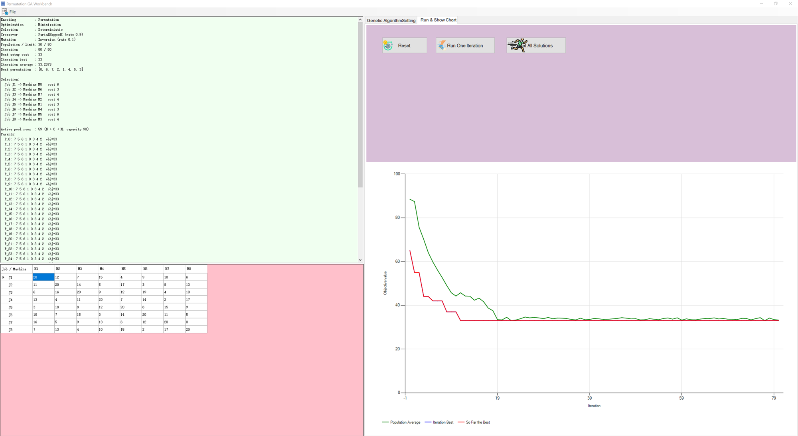

<div align="center">

# 🧬 Genetic Algorithm Workbench

**A portable Windows application and reusable C# library for binary, permutation, and real-valued genetic algorithms.**

[](https://learn.microsoft.com/dotnet/csharp/)
[](https://dotnet.microsoft.com/)
[](https://learn.microsoft.com/dotnet/desktop/winforms/)
[](#binary-ga)
[](#permutation-ga)
[](#real-coded-ga)
[](#download-and-run)
[](LICENSE)

</div>

---

## Download and run

Two self-contained applications are provided:

| Application | Portable folder | ZIP |
|---|---|---|
| Binary GA | `release/BinaryGAWorkbench/` | `release/BinaryGAWorkbench-win64.zip` |
| Permutation GA | `release/PermutationGAWorkbench/` | `release/PermutationGAWorkbench-win64.zip` |

Extract a ZIP, then double-click **`Launch.cmd`** or the application executable. Windows 10/11 includes the .NET Framework 4.8 runtime.

### Demo mode

```powershell
BinaryGAWorkbench.exe --demo --run 80
PermutationGAWorkbench.exe --demo --run 80
```

Both demos load a bundled cost matrix, run the solver, and open the populated result and convergence tabs.

---

## Screenshot

<div align="center">
  
  <br>
  <em>Permutation GA Workbench: cost matrix, decoded selection, best objective, and convergence history.</em>
</div>

---

## What it does

The application solves **selection-style optimisation problems**: choose one column per row so that the total cost is minimised. It is a practical demonstration of three genetic encodings.

### Binary GA

- chromosome: `n × n` bits, one bit per row/column pair;
- fitness combines cost and row/column violation penalties;
- one-point, two-point, and N-point crossover;
- gene-based or chromosome-based mutation;
- deterministic or stochastic selection;
- violation report for every row and column.

### Permutation GA

- chromosome: a permutation of `0..n-1`, one column per row;
- always feasible for a square matrix;
- PMX, order, position-based, order-based, and cycle crossover;
- inversion, insertion, displacement, reciprocal-exchange, and heuristic mutation;
- deterministic or stochastic selection.

### Real-coded GA

The reusable library also implements bounded real-valued chromosomes with:

- LVD, SVD, MOES, TES, and FBMS crossover;
- dynamic mutation;
- box constraints;
- the same selection, elitism, and convergence reporting.

### Shared engine

`GALibrary` provides:

- population management;
- fitness scaling;
- deterministic and roulette-wheel selection;
- elitism;
- convergence series for the WinForms chart;
- parameter validation;
- a documented objective-function contract.

---

## Algorithms and operators

| Component | Binary | Permutation | Real-valued |
|---|---|---|---|
| Representation | bit string | permutation | double vector |
| Crossover | 1-point, 2-point, N-point | PMX, OX, POS, OX2, cycle | LVD, SVD, MOES, TES, FBMS |
| Mutation | bit flip | inversion, insertion, displacement, swap, heuristic | dynamic |
| Feasibility | penalty-based | preserved by operators | box-clamped |
| Typical use | subset selection | selection/sequencing | continuous optimisation |

Selection can be deterministic (best individuals survive) or stochastic (fitness-proportionate). Elitism keeps the best solution found so far.

---

## Screens and controls

| Control | Action |
|---|---|
| **Random Generate System** | Create a square cost matrix with configurable size and range. |
| **Encoding** | Switch between binary and permutation representations. |
| **Parameters** | Set population, crossover rate, mutation rate, penalty, and selection mode. |
| **Optimization** | Choose minimisation or maximisation. |
| **Run & Show Chart** | Reset, run one generation, run to the limit, and inspect convergence. |
| **File → Open / Save** | Load or save `.aop` cost-matrix files. |

### `.aop` format

```text
5
20 12 7 15 4
11 20 14 5 17
6 16 20 9 12
13 4 11 20 7
3 18 8 12 20
```

The first line is the matrix size; the following lines contain the cost matrix. Blank lines and `#` comments are ignored.

---

## Project structure

```text
GeneticAlgorithm/
├── Generic GA Solver and a Binary GA Implementation/
│   ├── GALibrary/                      # shared genetic algorithm engine
│   ├── BinaryGAWorkbench/              # binary-encoded application
│   ├── BinaryGAWorkbench.sln
│   └── samples/
├── Permutation-Encoded GAs/
│   ├── GALibrary/                      # matched library copy
│   ├── PermutationGAWorkbench/         # permutation-encoded application
│   ├── PermutationGAWorkbench.sln
│   └── samples/
├── release/
│   ├── BinaryGAWorkbench-win64.zip
│   └── PermutationGAWorkbench-win64.zip
├── docs/screenshots/main.png
├── README.md
└── LICENSE
```

---

## Build from source

**Requirements:** Windows 10/11, Visual Studio 2022/2026 with .NET desktop development, or MSBuild with the .NET Framework 4.8 targeting pack.

```powershell
& 'C:\Program Files\Microsoft Visual Studio\18\Community\MSBuild\Current\Bin\MSBuild.exe' `
  '.\Generic GA Solver and a Binary GA Implementation\BinaryGAWorkbench.sln' `
  /t:Restore,Build /p:Configuration=Release /v:minimal /nologo

& 'C:\Program Files\Microsoft Visual Studio\18\Community\MSBuild\Current\Bin\MSBuild.exe' `
  '.\Permutation-Encoded GAs\PermutationGAWorkbench.sln' `
  /t:Restore,Build /p:Configuration=Release /v:minimal /nologo
```

Outputs:

```text
Generic GA Solver and a Binary GA Implementation\BinaryGAWorkbench\bin\Release\BinaryGAWorkbench.exe
Permutation-Encoded GAs\PermutationGAWorkbench\bin\Release\PermutationGAWorkbench.exe
```

Use MSBuild rather than `dotnet build`: these are classic .NET Framework WinForms projects.

### Verification

Both applications expose a headless self-test:

```powershell
BinaryGAWorkbench.exe --selftest
PermutationGAWorkbench.exe --selftest
```

The suite covers chromosome validity, every crossover and mutation operator, selection, convergence, `.aop` parsing, and objective evaluation. The current build passes **1,557 checks with 0 failures**.

---

## Notes and limitations

- The binary encoding is penalty-based and can converge to feasible but suboptimal selections; the permutation encoding is recommended for selection problems.
- The real-valued solver is a library component; the two desktop applications focus on binary and permutation encodings.
- Results are stochastic and depend on the seed, population size, and generation budget.
- The repository contains matched library copies inside each solution so either solution can be opened independently.

---

## References

- Holland, J. H. (1975). *Adaptation in Natural and Artificial Systems.* University of Michigan Press.
- Goldberg, D. E. (1989). *Genetic Algorithms in Search, Optimization, and Machine Learning.* Addison-Wesley.
- Michalewicz, Z. (1996). *Genetic Algorithms + Data Structures = Evolution Programs.* Springer.

---

## License

MIT License. See [LICENSE](LICENSE).

<div align="center">

Built with 🧬, 📈 and C# by **Benny Lin**  
[GitHub @BennyLinntu](https://github.com/BennyLinntu)

</div>

